# react-svg-path

react-svg-path makes composing svg elements dead simple. Everything is a path. Have fun.

There are more docs and interactive demos at https://joemaddalone.github.io/react-svg-path-docs/

## Table of contents

- [Installation](#install)
- [Path](#path)
- [toComponent](#tocomponent)
- [Transforms & Manipulation Props](#transforms--manipulation-props)
- [Attachment & Orientation](#attachment--orientation)
- [Hooks & Additional Components](#hooks--additional-components)
  - [usePath](#usepath)
  - [AlongPath](#alongpath)
  - [CanvasPath](#canvaspath)
  - [Svg autoFit](#svg-autofit)
  - [TextPath](#textpath)
- [Components](#components)
  - [Shapes](#shapes)
    - [Circle](#circle)
    - [Cross](#cross)
    - [Ellipse](#ellipse)
    - [Isocube](#isocube)
    - [Kite](#kite)
    - [Lens](#lens)
    - [Line](#line)
    - [Omino](#omino)
    - [Polygon](#polygon)
    - [Polygram](#polygram)
    - [Polyline](#polyline)
    - [RadialLines](#radiallines)
    - [Rect](#rect)
    - [RegPolygon](#regpolygon)
    - [RoundedRect](#roundedrect)
    - [RoundedSquare](#roundedsquare)
    - [Sector](#sector)
    - [Segment](#segment)
    - [Square](#square)
    - [Star](#star)
    - [SymH](#symh)
    - [SymI](#symi)
    - [SymV](#symv)
    - [SymX](#symx)
    - [Triangle](#triangle)
  - [Curves](#curves)
    - [Arc](#arc)
    - [Cubic](#cubic)
    - [Quad](#quad)
## Install

```bash
npm install --save react-svg-path
```

## Path

```
import Path from 'react-svg-path'
```

react-svg-path is mostly helpful for building the commands needed for the "d" attribute of an svg path.

Most methods are direct translations from the [SVG Path specification](https://developer.mozilla.org/en-US/docs/Web/SVG/Tutorial/Paths).

`<path d="M0 0, L0 100"></path>`

This path can be produced with:

```
const path = new Path().M(0,0).L(0,100);
console.log(path.toString()) // M0 0, L0 100
```

This library wraps https://github.com/joemaddalone/path and further documentation can be found there.  All of the functionality of [path](https://github.com/joemaddalone/path) is always available via `import Path from 'react-svg-path'` Please read the docs on [path](https://github.com/joemaddalone/path)

## toComponent

This library adds one additional rendering method to `path` called `toComponent`.

- **toComponent**(_props_)
  - returns a jsx function including attributes and props.


```jsx
import React from 'react';
import Path, {Svg}  from 'react-svg-path';

const CustomSquare = ({ x, y, size }) => {
  const path = new Path()
    .moveTo(x, y) // move pen to x, y
    .right(size) // draw line right to relative "size" px
    .down(size) // draw line down to relative "size" px
    .left(size) // draw line left to relative "size" px
    .close() // draw line back to first point
  return path.toComponent({ fill: 'green'});
};

const App = () => {
  const width = 800;
  const height = 800;
  return (
    <Svg
      width={width}
      height={height}
    >
      <CustomSquare x={50} y={50} size={50} />
    </Svg>
  );
};
```

## Transforms & Manipulation Props

Every shape component and `<PathMerge>` supports baked geometric transforms and path normalization powered by `@joemaddalone/path`:

- `rotate`: `number | [degrees, originX?, originY?]` — rotates clockwise in degrees (defaults pivot to shape center when omitted)
- `scale`: `number | [sx, sy?, originX?, originY?]` — uniform or non-uniform scale (defaults pivot to shape center when omitted)
- `translate`: `[dx, dy]` — shifts all coordinates
- `matrix`: `[a, b, c, d, e, f]` — applies a 2D affine matrix
- `reverse`: `boolean` — flips traversal direction and winding order (useful for `fillRule="evenodd"` cutouts in `<PathMerge>` or reversed stroke draw-ins)
- `coordinateMode`: `'absolute' | 'relative'` — normalizes output commands

```jsx
<PathMerge fillRule="evenodd" rotate={15}>
  <Rect width={120} height={120} cx={100} cy={100} />
  <Circle size={50} cx={100} cy={100} reverse />
</PathMerge>
```

## Attachment & Orientation

Nested children automatically attach to their parent's resolved path geometry via `attach`:

- `'start'` | `'end'` (default `'end'`)
- `number` (`0` to `1`) — parametric position along the path via `getPointAtLength()`
- Bounding-box anchors — `'top'`, `'bottom'`, `'left'`, `'right'`, `'topLeft'`, `'topRight'`, `'bottomLeft'`, `'bottomRight'`, `'center'`
- `orientToPath`: `boolean` — rotates the nested child to follow the parent path's tangent at the attachment point

```jsx
<Line sx={20} sy={100} ex={220} ey={40}>
  <Triangle size={16} attach={0.5} orientToPath />
  <Text attach="top" oy={-8}>Midpoint</Text>
</Line>
```

## Hooks & Additional Components

### usePath

Memoizes a `Path` builder and returns SSR-safe geometry metrics synchronously during render:

```jsx
import { usePath } from 'react-svg-path';

const AnimatedCurve = ({ progress }) => {
  const { d, length, bbox, pointAtPercent, tangentAtPercent } = usePath(
    (p) => p.M(10, 80).C(60, 10, 140, 10, 190, 80),
    []
  );
  return (
    <path
      d={d}
      fill="none"
      stroke="black"
      strokeDasharray={length}
      strokeDashoffset={length * (1 - progress)}
    />
  );
};
```

### AlongPath

Distributes items evenly along any `Path` instance or shape component, with optional tangent orientation:

```jsx
import { AlongPath, Arc, Triangle } from 'react-svg-path';

<AlongPath path={<Arc sx={20} sy={100} rx={80} ry={80} ex={180} ey={100} />} count={5} orient showPath>
  <Triangle size={12} fill="coral" />
</AlongPath>
```

### CanvasPath

Renders a `Path` instance or child shape components onto an HTML5 `<canvas>` 2D context via `toCanvas()`:

```jsx
import { CanvasPath, Star } from 'react-svg-path';

<CanvasPath width={200} height={200} fill="gold" stroke="#333" lineWidth={2}>
  <Star outerSize={140} innerSize={60} points={5} cx={100} cy={100} />
</CanvasPath>
```

### Svg autoFit

Computes a tight `viewBox` (and default `width`/`height`) from child path bounding boxes without requiring a DOM:

```jsx
<Svg autoFit padding={16}>
  <Circle size={100} cx={120} cy={120} />
</Svg>
```

### TextPath

Accepts a `Path` instance, shape component, or `d` string, and supports `reverse` to flip text orientation along arcs or circles:

```jsx
<TextPath path={<Circle size={120} cx={100} cy={100} />} reverse>
  Text along a reversed path
</TextPath>
```

## Components

Writing path commands via the library makes creating paths super simple and intuitive.  However it can seem like overkill for really common patterns you may need.  react-svg-path includes a number of components to allow for a declarative interface for generating the paths you need.

_Note: The following shorthand version of some props are available where applicable:_
* **sxy**: sx & sy = sxy
* **exy**: ex & ey = exy
* **cxy**: cx & cy = cxy
* **rxy**: rx & cy = rxy

The following components are available

## Shapes
 ### Circle

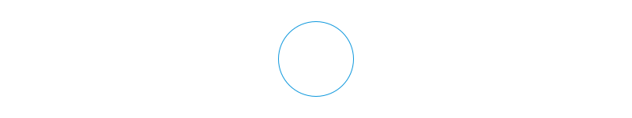

[→ Interactive demo of Circle](https://joemaddalone.github.io/react-svg-path-docs/#/circle)

```js
<Circle 
  centerEnd={boolean|default = true} 
  cx={number} 
  cy={number} 
  size={number} 
/>
```

<details>

<summary>Props overview</summary>

Prop|Type|Description|Required|Default
:-|:-|:-|:-|:-
size|number|Circumference of the Circle.|true|
cx|number|Center x coordinate of the Circle.|true|
cy|number|Center x coordinate of the Circle.|true|
centerEnd|boolean|Determines whether cursor should return to cx & cy as a last step.|false|true

</details>


-----

### Cross


[→ Interactive demo of Cross](https://joemaddalone.github.io/react-svg-path-docs/#/cross)

```js
<Cross 
  centerEnd={boolean|default = true} 
  cx={number} 
  cy={number} 
  height={number} 
  width={number} 
/>
```

<details>

<summary>Props overview</summary>

Prop|Type|Description|Required|Default
:-|:-|:-|:-|:-
width|number|Width of the Cross.|true|
height|number|Height of the Cross.|true|
cx|number|Center x coordinate of the Cross.|true|
cy|number|Center x coordinate of the Cross.|true|
centerEnd|boolean|Determines whether cursor should return to cx & cy as a last step.|false|true

</details>


-----

### Ellipse

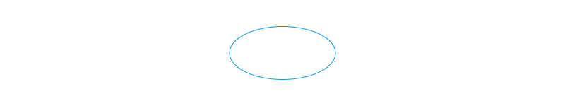

[→ Interactive demo of Ellipse](https://joemaddalone.github.io/react-svg-path-docs/#/ellipse)

```js
<Ellipse 
  centerEnd={boolean|default = true} 
  cx={number} 
  cy={number} 
  height={number} 
  width={number} 
/>
```

<details>

<summary>Props overview</summary>

Prop|Type|Description|Required|Default
:-|:-|:-|:-|:-
width|number|Width of the Ellipse.|true|
height|number|Height of the Ellipse.|true|
cx|number|Center x coordinate of the Ellipse.|true|
cy|number|Center x coordinate of the Ellipse.|true|
centerEnd|boolean|Determines whether cursor should return to cx & cy as a last step.|false|true

</details>


-----

### Isocube

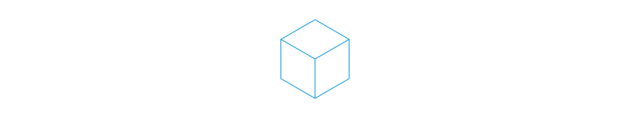

[→ Interactive demo of Isocube](https://joemaddalone.github.io/react-svg-path-docs/#/isocube)

```js
<Isocube 
  centerEnd={boolean|default = true} 
  cx={number} 
  cy={number} 
  size={number} 
/>
```

<details>

<summary>Props overview</summary>

Prop|Type|Description|Required|Default
:-|:-|:-|:-|:-
size|number|Equal size of the Isocube.|true|
cx|number|Center x coordinate of the Isocube.|true|
cy|number|Center x coordinate of the Isocube.|true|
centerEnd|boolean|Determines whether cursor should return to cx & cy as a last step.|false|true

</details>


-----

### Kite

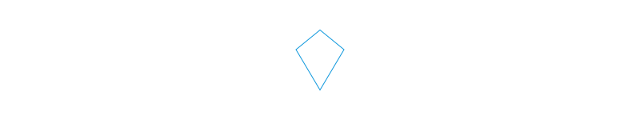

[→ Interactive demo of Kite](https://joemaddalone.github.io/react-svg-path-docs/#/kite)

```js
<Kite 
  centerEnd={boolean|default = true} 
  cx={number} 
  cy={number} 
  dh={number} 
  height={number} 
  width={number} 
/>
```

<details>

<summary>Props overview</summary>

Prop|Type|Description|Required|Default
:-|:-|:-|:-|:-
width|number|Width of the Kite.|true|
height|number|Height of the Kite.|true|
dh|number|Vertical position of the left and right points from the top.|true|
cx|number|Center x coordinate of the Kite.|true|
cy|number|Center x coordinate of the Kite.|true|
centerEnd|boolean|Determines whether cursor should return to cx & cy as a last step.|false|true

</details>


-----

### Lens

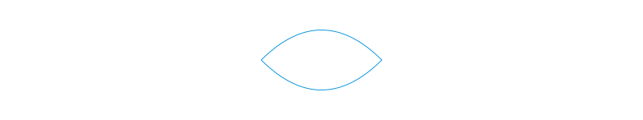

[→ Interactive demo of Lens](https://joemaddalone.github.io/react-svg-path-docs/#/lens)

```js
<Lens 
  centerEnd={boolean|default = true} 
  cx={number} 
  cy={number} 
  height={number} 
  width={number} 
/>
```

<details>

<summary>Props overview</summary>

Prop|Type|Description|Required|Default
:-|:-|:-|:-|:-
width|number|Width of the Lens.|true|
height|number|Height of the Lens.|true|
cx|number|Center x coordinate of the Lens.|true|
cy|number|Center x coordinate of the Lens.|true|
centerEnd|boolean|Determines whether cursor should return to cx & cy as a last step.|false|true

</details>


-----

### Line

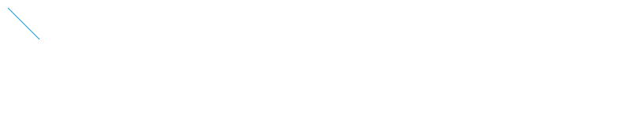

[→ Interactive demo of Line](https://joemaddalone.github.io/react-svg-path-docs/#/line)

```js
<Line 
  ex={number} 
  ey={number} 
  relative={boolean|default = false} 
  sx={number} 
  sy={number} 
/>
```

<details>

<summary>Props overview</summary>

Prop|Type|Description|Required|Default
:-|:-|:-|:-|:-
sx|number|Starting x coordinate for the Line.|true|
sy|number|Starting y coordinate for the Line.|true|
ex|number|Ending x coordinate for the Line.|true|
ey|number|Ending y coordinate for the Line.|true|
relative|boolean|If set to true ex & ey will become relative to sx & sy.|true|false

</details>


-----

### Omino

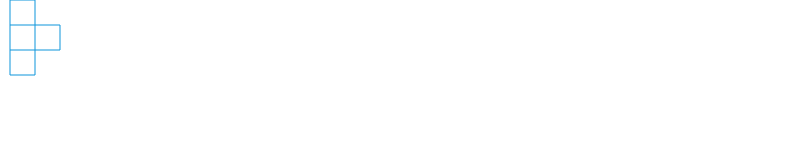

[→ Interactive demo of Omino](https://joemaddalone.github.io/react-svg-path-docs/#/omino)

```js
<Omino 
  lined={boolean|default = false} 
  shape={2d-array} 
  size={number} 
  sx={number} 
  sy={number} 
/>
```

<details>

<summary>Props overview</summary>

Prop|Type|Description|Required|Default
:-|:-|:-|:-|:-
size|number|Size of the squares.|true|
shape|2d-array|2d array of the Omino.|true|
sx|number|Starting x coordinate for left.|true|
sy|number|Starting y coordinate for top.|true|
lined|boolean|Draw inner lines or not.|false|false

</details>


-----

### Polygon

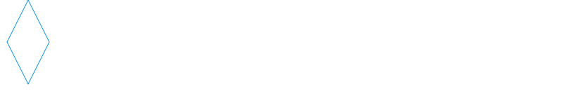

[→ Interactive demo of Polygon](https://joemaddalone.github.io/react-svg-path-docs/#/polygon)

```js
<Polygon 
  points={point-array} 
/>
```

<details>

<summary>Props overview</summary>

Prop|Type|Description|Required|Default
:-|:-|:-|:-|:-
points|point-array|x, y, points of the polygon.|true|

</details>


-----

### Polygram

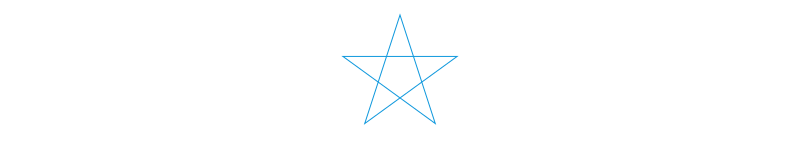

[→ Interactive demo of Polygram](https://joemaddalone.github.io/react-svg-path-docs/#/polygram)

```js
<Polygram 
  centerEnd={boolean|default = true} 
  cx={number} 
  cy={number} 
  points={number} 
  size={number} 
  vertexSkip={number|default = 2} 
/>
```

<details>

<summary>Props overview</summary>

Prop|Type|Description|Required|Default
:-|:-|:-|:-|:-
size|number|Size of the underlying polygon.|true|
points|number|Number of points to create.|true|
cx|number|Center x coordinate of the Polygram.|true|
cy|number|Center x coordinate of the Polygram.|true|
vertexSkip|number|Integer representing which vertex to go to next relative to current.|false|2
centerEnd|boolean|Determines whether cursor should return to cx & cy as a last step.|false|true

</details>


-----

### Polyline

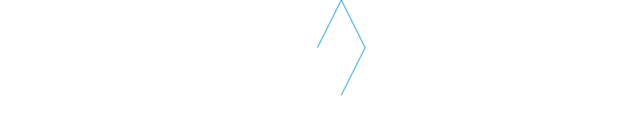

[→ Interactive demo of Polyline](https://joemaddalone.github.io/react-svg-path-docs/#/polyline)

```js
<Polyline 
  points={point-array} 
  relative={boolean|default = false} 
/>
```

<details>

<summary>Props overview</summary>

Prop|Type|Description|Required|Default
:-|:-|:-|:-|:-
points|point-array|x, y, points of the Polyline.|true|
relative|boolean|If set to true all points will be relative.|false|false

</details>


-----

### RadialLines

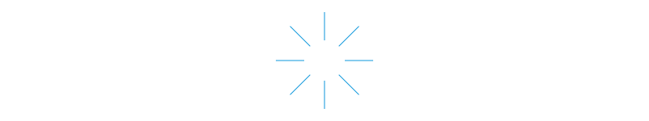

[→ Interactive demo of RadialLines](https://joemaddalone.github.io/react-svg-path-docs/#/radialLines)

```js
<RadialLines 
  centerEnd={boolean|default = true} 
  cx={number} 
  cy={number} 
  innerSize={number} 
  outerSize={number} 
  points={number} 
/>
```

<details>

<summary>Props overview</summary>

Prop|Type|Description|Required|Default
:-|:-|:-|:-|:-
outerSize|number|Circumference of the outer circle.|true|
innerSize|number|Circumference of the inner circle.|true|
points|number|Number of lines to draw.|true|
cx|number|Center x coordinate of the RadialLines.|true|
cy|number|Center x coordinate of the RadialLines.|true|
centerEnd|boolean|Determines whether cursor should return to cx & cy as a last step.|false|true

</details>


-----

### Rect

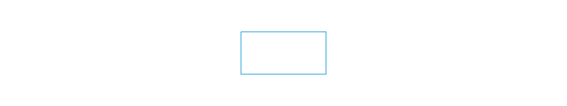

[→ Interactive demo of Rect](https://joemaddalone.github.io/react-svg-path-docs/#/rect)

```js
<Rect 
  centerEnd={boolean|default = true} 
  cx={number} 
  cy={number} 
  height={number} 
  width={number} 
/>
```

<details>

<summary>Props overview</summary>

Prop|Type|Description|Required|Default
:-|:-|:-|:-|:-
width|number|Width of the Rect.|true|
height|number|Height of the Rect.|true|
cx|number|Center x coordinate of the Rect.|true|
cy|number|Center x coordinate of the Rect.|true|
centerEnd|boolean|Determines whether cursor should return to cx & cy as a last step.|false|true

</details>


-----

### RegPolygon

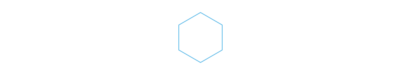

[→ Interactive demo of RegPolygon](https://joemaddalone.github.io/react-svg-path-docs/#/regPolygon)

```js
<RegPolygon 
  centerEnd={boolean|default = true} 
  cx={number} 
  cy={number} 
  sides={number} 
  size={number} 
/>
```

<details>

<summary>Props overview</summary>

Prop|Type|Description|Required|Default
:-|:-|:-|:-|:-
size|number|Size of the RegPolygon.|true|
sides|number|Number of sides of the RegPolygon.|true|
cx|number|Center x coordinate of the RegPolygon.|true|
cy|number|Center x coordinate of the RegPolygon.|true|
centerEnd|boolean|Determines whether cursor should return to cx & cy as a last step.|false|true

</details>


-----

### RoundedRect

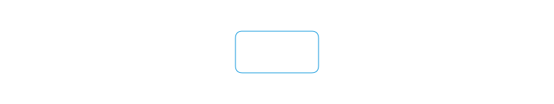

[→ Interactive demo of RoundedRect](https://joemaddalone.github.io/react-svg-path-docs/#/roundedRect)

```js
<RoundedRect 
  centerEnd={boolean|default = true} 
  cx={number} 
  cy={number} 
  height={number} 
  radius={number} 
  width={number} 
/>
```

<details>

<summary>Props overview</summary>

Prop|Type|Description|Required|Default
:-|:-|:-|:-|:-
width|number|Width of the Rect.|true|
height|number|Height of the Rect.|true|
radius|number|Radius for the corners.|true|
cx|number|Center x coordinate of the RoundedRect.|true|
cy|number|Center x coordinate of the RoundedRect.|true|
centerEnd|boolean|Determines whether cursor should return to cx & cy as a last step.|false|true

</details>


-----

### RoundedSquare

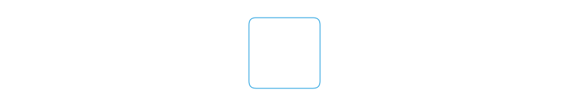

[→ Interactive demo of RoundedSquare](https://joemaddalone.github.io/react-svg-path-docs/#/roundedSquare)

```js
<RoundedSquare 
  centerEnd={boolean|default = true} 
  cx={number} 
  cy={number} 
  radius={number} 
  size={number} 
/>
```

<details>

<summary>Props overview</summary>

Prop|Type|Description|Required|Default
:-|:-|:-|:-|:-
size|number|Width &  height of the Square.|true|
radius|number|Radius for the corners.|true|
cx|number|Center x coordinate of the RoundedSquare.|true|
cy|number|Center x coordinate of the RoundedSquare.|true|
centerEnd|boolean|Determines whether cursor should return to cx & cy as a last step.|false|true

</details>


-----

### Sector

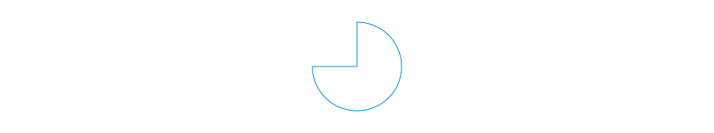

[→ Interactive demo of Sector](https://joemaddalone.github.io/react-svg-path-docs/#/sector)

```js
<Sector 
  centerEnd={boolean|default = true} 
  cx={number} 
  cy={number} 
  endAngle={number} 
  size={number} 
  startAngle={number} 
/>
```

<details>

<summary>Props overview</summary>

Prop|Type|Description|Required|Default
:-|:-|:-|:-|:-
cx|number|Center x coordinate of the Sector.|true|
cy|number|Center x coordinate of the Sector.|true|
size|number|Circumference of the Sector.|true|
startAngle|number|Start angle of the Sector.  0 = top center.|true|
endAngle|number|End angle of the Sector.  0 = top center.|true|
centerEnd|boolean|Determines whether cursor should return to cx & cy as a last step.|false|true

</details>


-----

### Segment

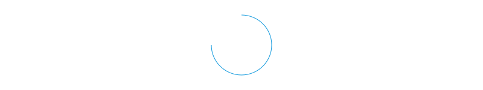

[→ Interactive demo of Segment](https://joemaddalone.github.io/react-svg-path-docs/#/segment)

```js
<Segment 
  centerEnd={boolean|default = true} 
  cx={number} 
  cy={number} 
  endAngle={number} 
  size={number} 
  startAngle={number} 
/>
```

<details>

<summary>Props overview</summary>

Prop|Type|Description|Required|Default
:-|:-|:-|:-|:-
cx|number|Center x coordinate of the Segment.|true|
cy|number|Center x coordinate of the Segment.|true|
size|number|Circumference of the Segment.|true|
startAngle|number|Start angle of the Segment.  0 = top center.|true|
endAngle|number|End angle of the Segment.  0 = top center.|true|
centerEnd|boolean|Determines whether cursor should return to cx & cy as a last step.|false|true

</details>


-----

### Square

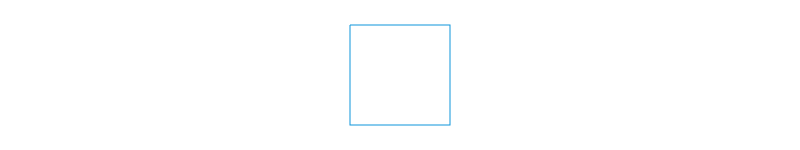

[→ Interactive demo of Square](https://joemaddalone.github.io/react-svg-path-docs/#/square)

```js
<Square 
  centerEnd={boolean|default = true} 
  cx={number} 
  cy={number} 
  size={number} 
/>
```

<details>

<summary>Props overview</summary>

Prop|Type|Description|Required|Default
:-|:-|:-|:-|:-
size|number|Width &  height of the Square.|true|
cx|number|Center x coordinate of the Square.|true|
cy|number|Center x coordinate of the Square.|true|
centerEnd|boolean|Determines whether cursor should return to cx & cy as a last step.|false|true

</details>


-----

### Star

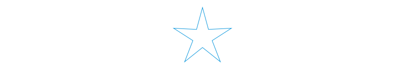

[→ Interactive demo of Star](https://joemaddalone.github.io/react-svg-path-docs/#/star)

```js
<Star 
  centerEnd={boolean|default = true} 
  cx={number} 
  cy={number} 
  innerSize={number} 
  outerSize={number} 
  points={number} 
/>
```

<details>

<summary>Props overview</summary>

Prop|Type|Description|Required|Default
:-|:-|:-|:-|:-
outerSize|number|The outer circumference where points will reach.|true|
innerSize|number|The inner circumference where points will end.|true|
points|number|Number of points for the Star.|true|
cx|number|Center x coordinate of the Star.|true|
cy|number|Center x coordinate of the Star.|true|
centerEnd|boolean|Determines whether cursor should return to cx & cy as a last step.|false|true

</details>


-----

### SymH

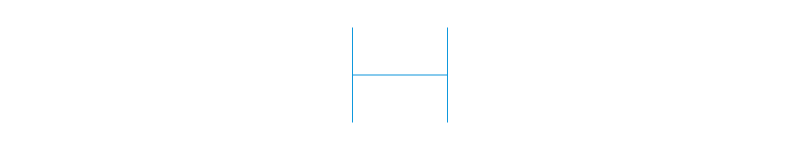

[→ Interactive demo of SymH](https://joemaddalone.github.io/react-svg-path-docs/#/symH)

```js
<SymH 
  centerEnd={boolean|default = true} 
  cx={number} 
  cy={number} 
  height={number} 
  width={number} 
/>
```

<details>

<summary>Props overview</summary>

Prop|Type|Description|Required|Default
:-|:-|:-|:-|:-
width|number|Width of the H.|true|
height|number|Height of the H.|true|
cx|number|Center x coordinate of the SymH.|true|
cy|number|Center x coordinate of the SymH.|true|
centerEnd|boolean|Determines whether cursor should return to cx & cy as a last step.|false|true

</details>


-----

### SymI

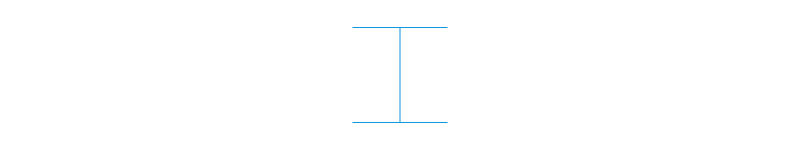

[→ Interactive demo of SymI](https://joemaddalone.github.io/react-svg-path-docs/#/symI)

```js
<SymI 
  centerEnd={boolean|default = true} 
  cx={number} 
  cy={number} 
  height={number} 
  width={number} 
/>
```

<details>

<summary>Props overview</summary>

Prop|Type|Description|Required|Default
:-|:-|:-|:-|:-
width|number|Width of the I.|true|
height|number|Height of the I.|true|
cx|number|Center x coordinate of the SymI.|true|
cy|number|Center x coordinate of the SymI.|true|
centerEnd|boolean|Determines whether cursor should return to cx & cy as a last step.|false|true

</details>


-----

### SymV

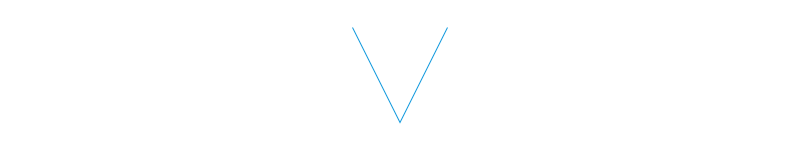

[→ Interactive demo of SymV](https://joemaddalone.github.io/react-svg-path-docs/#/symV)

```js
<SymV 
  centerEnd={boolean|default = true} 
  cx={number} 
  cy={number} 
  height={number} 
  width={number} 
/>
```

<details>

<summary>Props overview</summary>

Prop|Type|Description|Required|Default
:-|:-|:-|:-|:-
width|number|Width of the V.|true|
height|number|Height of the V.|true|
cx|number|Center x coordinate of the SymV.|true|
cy|number|Center x coordinate of the SymV.|true|
centerEnd|boolean|Determines whether cursor should return to cx & cy as a last step.|false|true

</details>


-----

### SymX

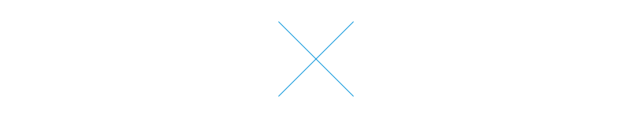

[→ Interactive demo of SymX](https://joemaddalone.github.io/react-svg-path-docs/#/symX)

```js
<SymX 
  centerEnd={boolean|default = true} 
  cx={number} 
  cy={number} 
  height={number} 
  width={number} 
/>
```

<details>

<summary>Props overview</summary>

Prop|Type|Description|Required|Default
:-|:-|:-|:-|:-
width|number|Width of the X.|true|
height|number|Height of the X.|true|
cx|number|Center x coordinate of the SymX.|true|
cy|number|Center x coordinate of the SymX.|true|
centerEnd|boolean|Determines whether cursor should return to cx & cy as a last step.|false|true

</details>


-----

### Triangle

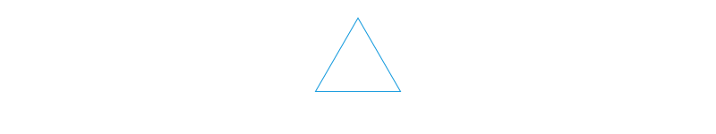

[→ Interactive demo of Triangle](https://joemaddalone.github.io/react-svg-path-docs/#/triangle)

```js
<Triangle 
  centerEnd={boolean|default = true} 
  cx={number} 
  cy={number} 
  size={number} 
/>
```

<details>

<summary>Props overview</summary>

Prop|Type|Description|Required|Default
:-|:-|:-|:-|:-
size|number|Size of the Tirangle.|true|
cx|number|Center x coordinate of the Triangle.|true|
cy|number|Center x coordinate of the Triangle.|true|
centerEnd|boolean|Determines whether cursor should return to cx & cy as a last step.|false|true

</details>


-----
## Curves
 ### Arc

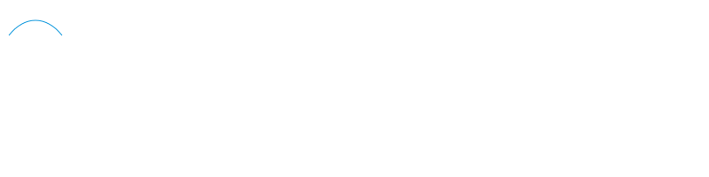

[→ Interactive demo of Arc](https://joemaddalone.github.io/react-svg-path-docs/#/arc)

```js
<Arc 
  arc={number|default = 0} 
  ex={number} 
  ey={number} 
  relative={boolean|default = false} 
  rotation={number|default = 0} 
  rx={number} 
  ry={number} 
  sweep={number|default = 0} 
  sx={number} 
  sy={number} 
/>
```

<details>

<summary>Props overview</summary>

Prop|Type|Description|Required|Default
:-|:-|:-|:-|:-
sx|number|Starting x coordinate for the Arc.|true|
sy|number|Starting y coordinate for the Arc.|true|
rx|number|Width of the underlying ellipse of the Arc.|true|
ry|number|Height of the underlying ellipse of the Arc.|true|
rotation|number|Rotation of the underlying ellipse of the Arc.|false|0
arc|number|Large arc flag: this says whether to follow the larger or smaller part of the underlying ellipse.|false|0
sweep|number|Sweep flag: think of this as direction flag, follow a clockwise or counterclockwise path along the underlying ellipse.|false|0
ex|number|Ending x coordinate for the Arc.|true|
ey|number|Ending y coordinate for the Arc.|true|
relative|boolean|If set to true all points after sx & sy will become relative to sx & sy.|false|false

</details>


-----

### Cubic

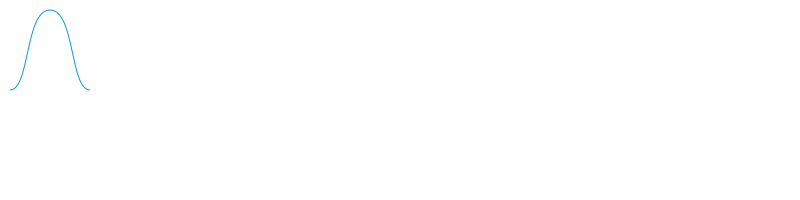

[→ Interactive demo of Cubic](https://joemaddalone.github.io/react-svg-path-docs/#/cubic)

```js
<Cubic 
  S={point-array} 
  cx1={number} 
  cx2={number} 
  cy1={number} 
  cy2={number} 
  ex={number} 
  ey={number} 
  relative={boolean|default = false} 
  s={point-array} 
  sx={number} 
  sy={number} 
/>
```

<details>

<summary>Props overview</summary>

Prop|Type|Description|Required|Default
:-|:-|:-|:-|:-
sx|number|Starting x coordinate for the Cubic.|true|
sy|number|Starting y coordinate for the Cubic.|true|
cx1|number|x coordinate for control point 1.|true|
cy1|number|y coordinate for control point 1.|true|
cx2|number|x coordinate for control point 2.|true|
cy2|number|y coordinate for control point 2.|true|
ex|number|Ending x coordinate for the Cubic.|true|
ey|number|Ending y coordinate for the Cubic.|true|
S|point-array|Optionally String together multiple Cubic wit an array consisting of 2 or more control points.|false|
s|point-array|Optional relative "smoooth curve" array consisting of 2 or more control points.|false|
relative|boolean|If set to true all points after sx & sy will become relative to sx & sy.|false|false

</details>


-----

### Quad

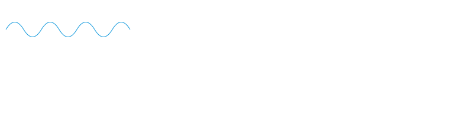

[→ Interactive demo of Quad](https://joemaddalone.github.io/react-svg-path-docs/#/quad)

```js
<Quad 
  T={point-array} 
  cx={number} 
  cy={number} 
  ex={number} 
  ey={number} 
  relative={boolean|default = false} 
  sx={number} 
  sy={number} 
  t={point-array} 
/>
```

<details>

<summary>Props overview</summary>

Prop|Type|Description|Required|Default
:-|:-|:-|:-|:-
sx|number|Starting x coordinate for the Quad.|true|
sy|number|Starting y coordinate for the Quad.|true|
cx|number|x coordinate for the control point.|true|
cy|number|y coordinate for the control point.|true|
ex|number|Ending x coordinate for the Quad.|true|
ey|number|Ending y coordinate for the Quad.|true|
T|point-array|String together multiple Quad curves.|false|
t|point-array|String together multiple Quad curves where coordinates are relative.|false|
relative|boolean|If set to true all points after sx & sy will become relative to sx & sy.|false|false

</details>


-----

## License

MIT © [joemaddalone](https://github.com/joemaddalone)